**TECHNOLOGICAL INSTITUTE OF THE PHILIPPINES** 
938 Aurora Boulevard, Cubao, Quezon City 
**College of Computer Studies** 
**Information Technology Department**

**Final Project in IT 009 — Systems Integration and Architecture 1** 
First Semester, S.Y. 2025–2026

# RePIXL: Development of a Vintage Digital Camera (Digicam) E-commerce Website

**Submitted by — Group 2, IT31S2**

- Romualdo, Jervin Paul C.
- Rosario, Ariane Joy P.
- Sevilla, Ma. Rosa Camilla S.
- Sostea, Joana Marie A.
- Tupaen, Arianne Kaye E. — Group Leader

**Submitted to:** Ms. Arceli F. Salo 
**Documentation date:** October 21, 2026

## Document status and evidence

This report consolidates the Phase 1 concept, Phase 2 architecture, Project Progress Checklist, and existing codebase. “RePIXL” is retained in the academic title; “RePXL” is the application/repository branding. The template's academic year is retained above but conflicts with the July–October 2026 project dates and must be confirmed before submission. IT31S2 follows Phase 2 and the checklist; the Phase 1 header also contains an older IT21S2 entry.

Implementation statements describe inspected source. Fresh automated results and a public catalog read are dated October 21, 2026. Earlier payment and Android checks are attributed to dated repository records. Missing screenshots, personal reflections, signatures, library evidence, and stress measurements are identified explicitly.

## Table of contents

1. [Introduction](#i-introduction)
2. [Related Literature](#ii-related-literature)
3. [Methodology](#iii-methodology)
4. [Conclusion and Recommendations](#iv-conclusion-and-recommendations)
5. [References](#v-references)
6. [User's Manual](#vi-users-manual)
7. [Members' Contribution](#vii-members-contribution)
8. [Appendices](#viii-appendices)
9. [Stress Testing Analysis and Data Results](#ix-stress-testing-analysis-and-data-results)

---

## I. Introduction

### 1. Background of the study

Older digital cameras offer distinctive designs, controls, and photographic output that interest collectors, hobby photographers, and users exploring retro photography. Buying used equipment requires information beyond a product name and price: buyers need to understand condition, specifications, availability, and the process for resolving problems after purchase.

RePIXL was proposed as a fictional small business that organizes these transactions through a dedicated e-commerce system. Phase 1 identified product discovery, accounts, ordering, inventory management, and administrative oversight. Phase 2 expanded the proposal into customer and administrator modules with shared data and service integrations. The implementation now includes a Next.js website, web administration, and an Expo/React Native customer application using a common backend and PostgreSQL database.

The business case focuses on fragmented product information, manual order recording, and inconsistent stock updates. This rationale comes from the group's requirements; no customer survey or field study establishing measured demand is present. Phase 1's numerical market projections are therefore not repeated as verified findings.

#### 1.1 Company logo

*Figure 1. Existing RePXL logo used as the company identity.*

The framed wordmark and red accent reflect the website's camera/viewfinder styling. Dark charcoal surfaces, red highlights, archival photography, and a light-theme alternative establish a consistent identity. The maintained asset is <code>public/images/logo-repxl.svg</code>; its original external design tool is not established.

#### 1.2 Company background, mission, and goals

RePIXL is a fictional student-developed business specializing in vintage and preloved digital cameras. Its founders, as identified in Phase 1, are the five Group 2 members on the title page. It aims to serve collectors and photography enthusiasts through organized listings and a consistent purchasing process.

Its mission is to encourage the reuse and appreciation of vintage cameras by making product information, condition grades, and transaction progress accessible. Detailed listings, comparison, reviews, shared stock records, and post-purchase support help implement this mission.

Phase 1 proposed 10,000 monthly visitors, at least three international partnerships, sustained business growth, and customer satisfaction. These remain aspirations: traffic, partnerships, revenue sustainability, and satisfaction outcomes were not measured here.

#### 1.3 Problem statement

The project addresses these operational problems:

1. Scattered listings make camera specifications, condition, and prices difficult to compare.
2. Manual stock recording can create disagreements between advertised and actual availability.
3. Separately recorded orders, payments, shipping details, and inquiries are difficult to reconcile.
4. Customers need consistent order history, updates, cancellation/returns, and feedback facilities.
5. Administrators need controlled catalog, customer, transaction, promotion, and audit tools.
6. Separate website/mobile records would duplicate data and increase inconsistency.

### 2. Project objectives

**General objective:** To develop an integrated e-commerce website for RePIXL that enables customers to discover and order vintage digital cameras while allowing administrators to manage products, inventory, customers, and transactions through shared business data.

**Specific objectives:**

1. Provide registration, login/logout, password recovery, profiles, and customer/admin access controls.
2. Present descriptions, images, prices, stock, grades, and specifications with search, filters, wishlist, and comparison.
3. Maintain customer carts and guide website checkout through Information, Shipping, Payment, and Review.
4. Integrate PayMongo processing and Cash on Delivery approval while identifying demonstration behavior.
5. Persist orders, inventory changes, voucher usage, payment references, and history in PostgreSQL.
6. Provide admin tools for cameras, orders, returns, customers, vouchers, content, notifications, and logs.
7. Support reviews, notifications, contact guidance, and return/refund workflows.
8. Connect a native customer client to the same backend and commerce records.
9. Evaluate the implementation through source inspection, TypeScript, automated tests, compilation, and separately identified manual evidence.

### 3. Significance of the study

| Beneficiary | Expected contribution |
|---|---|
| Customers | Organized product information, comparison, condition grading, order visibility, and support/returns. |
| Company/administrators | Centralized catalog, stock, orders, customers, promotions, content, and audit records. |
| Student developers | Experience integrating interfaces, APIs, authentication, payments, relational data, and tests. |
| Future developers | Modular source, migrations, shared contracts, and maintained documentation for extensions. |
| Camera community | A concept supporting continued use of older photography equipment; environmental benefits are not quantified. |

### 4. Scope and delimitations

#### 4.1 Scope

The website includes Home, About, Contact, FAQ, condition grading, catalog/detail, search/filtering, compare, wishlist, cart, four-step checkout, confirmation, and account pages. Accounts include profiles, addresses, orders, reviews, vouchers, notifications, and security.

Administrators have a separate login and dashboard, cameras, orders, returns, customers, vouchers, CMS pages/banners/homepage, notification templates, admin accounts, archives, logs, and settings. Account administration includes super-admin restrictions. Camera archiving retains history; custom CMS pages provide a separate create/read/update/delete workflow.

The native customer application implements shopping/account screens, comparison and color simulation, selective cart checkout, hosted payment handoff, tracking, reviews, returns, notifications, and support. It uses the website's backend and customer-owned records.

PostgreSQL hosted on Supabase stores data through server-side Prisma. Integrations include PayMongo, Google OAuth, Cloudinary, Nodemailer/Gmail SMTP, and optional Expo push. Vercel hosts the website/backend.

#### 4.2 Delimitations and actual implementation limits

| Area | Actual boundary or outstanding work |
|---|---|
| Architecture | Modules share one Next.js application/database. Independently deployed internal microservices are not established. |
| Product requirement | The public API returned **29 active products** on October 21, 2026. The committed seed/local fixture each contain **12**. At least 30 fully evidenced products remains an open requirement. |
| Categories | Phase 1 proposed accessories and photography extras. The inspected active catalog contains cameras; those accessory categories are not demonstrated as delivered inventory. |
| Payments | PayMongo is implemented. Sandbox and live merchant payments are distinct. A PayPal UI option does not establish a separate PayPal integration. |
| Demo fallback | Unconfigured PayMongo triggers a demonstration finalization branch in process-payment. It is not provider-confirmed payment. COD has separate approval/collection states. |
| Delivery | Courier choices, status, tracking, and simulation exist. Flat fees are J&T ₱150, LBC ₱200, Ninja Van ₱120, and Grab Express ₱300. Live quotation, booking, and physical GPS are not verified. |
| Analytics | Dashboard summaries exist; <code>/admin/reports</code> displays “Sales analytics coming soon.” Standalone reports remain partial. |
| Developer profiles | About shows fictional business-role cards, not five named student developer profiles/photos. Member portraits are included in this report. |
| Security | TOTP and step-up exist in source/tests. A complete live enrollment/login/disable sequence remains unverified. Previously identified production-origin configuration was not re-audited here. |
| Saved cards | The account payment-method interface uses browser localStorage, not a database-backed/provider payment vault. No PCI DSS certification is claimed. |
| Support/notifications | Concierge responses are keyword/rule-based. In-app/email notifications are implemented; physical-device push and Gmail rendering remain separate checks. Staffed chat, generative AI, and SMS delivery are not established. |
| Native release | Existing records document emulator installation/launch on October 21. Complete journeys on that APK, physical devices, iOS distribution, and store acceptance remain open. |
| Quality targets | Phase 1 response-time, uptime, scalability, and satisfaction goals remain targets without corresponding runtime measurements. |
| Deployment | Source/local build do not establish deployed commits or migrations. Check return-workflow, mobile-session, and push prerequisites in the target environment before demonstration. |

---

## II. Related Literature

### 1. E-commerce adoption and operational readiness

The OECD's *E-commerce in the time of COVID-19* discusses expanded online purchasing and challenges in adapting to digital commerce. For RePIXL, the relevant design implication is supporting a complete transaction process, connecting discovery, orders, payment, and customer records. This is a project application of the report, not evidence of RePIXL's commercial adoption. [OECD, 2020](https://www.oecd.org/en/publications/2020/10/e-commerce-in-the-time-of-covid-19_bb699f3a.html).

### 2. Reuse and electronic waste

The *Global E-waste Monitor 2024* from ITU and UNITAR reports growth in electronic waste and gaps in documented collection/recycling. RePIXL's interest in reusing functioning cameras is consistent with extending electronics' useful life. This connection is a project inference: the report does not study RePIXL, and avoided waste/emissions were not measured. [ITU and UNITAR, 2024](https://ewastemonitor.info/the-global-e-waste-monitor-2024/).

### 3. Architecture and integration

Publisher descriptions of *Software Architecture in Practice* and *Fundamentals of Software Architecture* emphasize architectural design, patterns, evaluation, and tradeoffs. These provide a suitable foundation for examining shared backend responsibilities and external dependencies. RePIXL favors common data and centralized transactions; source folders alone do not prove independent services. Publisher descriptions/bibliographic details were checked; complete-book access and T.I.P. library copies were not established. [Bass, Clements, and Kazman, 2021](https://www.informit.com/store/software-architecture-in-practice-9780136886020); [Richards and Ford, 2020](https://www.thoughtworks.com/insights/books/fundamentals-of-software-architecture).

### 4. Transaction integrity and asynchronous payments

PostgreSQL documents transactions as related changes that succeed or fail together. PayMongo describes payment creation, customer authentication/handoff, and webhook confirmation. RePIXL applies these concepts by separating payment-screen navigation from confirmed server state. Its finalizer coordinates paid-state transition, guarded stock deduction, voucher usage, and cart updates, with a guard against repeating purchase effects. [PostgreSQL, Transactions](https://www.postgresql.org/docs/current/tutorial-transactions.html); [PayMongo, Payments quick start](https://docs.paymongo.com/docs/payment-acceptance-quick-start).

### 5. Security and accessibility

OWASP ASVS provides application security requirements, while WCAG 2.2 provides testable accessibility criteria. RePIXL applies related practices through authentication/ownership checks, validation, safe error messages, keyboard focus, responsive interfaces, and reduced-motion handling. These are evaluation references; the current checks do not establish full ASVS or WCAG conformance. [OWASP ASVS](https://asvs.owasp.org/); [W3C, 2024](https://www.w3.org/TR/WCAG22/).

---

## III. Methodology

### 1. Development approach

The documents and repository support an iterative process: Phase 1 defined the concept/requirements; Phase 2 described architecture and module dependencies; later implementation/checklist entries record features, corrections, and checks. This report compares plans with source rather than assuming all planned work is complete.

| Stage | Activities | Evidence |
|---|---|---|
| Concept | Identity, mission, operational problems, requirements, future scope. | Phase 1. |
| Architecture | Client/admin responsibilities, shared records, integrations. | Phase 2. |
| Implementation | Routes/components, libraries, schema/migrations, native screens/adapters. | Existing source and manifests. |
| Verification | Static checks, regressions, compilation, separately attributed runtime evidence. | Fresh checks and dated guides/checklist. |
| Reconciliation | Record actual behavior, remaining work, and submission evidence. | This report, checklist, README. |

No interviews, survey sample, sprint schedule, controlled user experiment, or individual coding authorship is inferred.

### 2. System architecture

#### 2.1 High-level system diagram

~~~mermaid
flowchart TB
    Web[Customer website] --> API[Next.js route handlers]
    Admin[Administrator website] --> API
    Native[Expo and React Native customer app] --> API
    API --> Guards[Authentication, ownership, role and validation checks]
    Guards --> Modules[Commerce, account, content and notification modules]
    Modules --> ORM[Server-side Prisma]
    ORM --> DB[(PostgreSQL hosted on Supabase)]
    Modules --> Payments[PayMongo]
    Payments --> Hooks[Signed payment and refund webhooks]
    Hooks --> Modules
    Modules --> Media[Cloudinary images]
    Modules --> Mail[Nodemailer and Gmail SMTP]
    Modules --> Push[Optional Expo push]
    Google[Google OAuth through NextAuth] --> API
~~~

*Figure 2. Architecture reconstructed from source. Vercel hosts Next.js and its API; the native client is distributed separately.*

The design uses client-server communication and presentation, HTTP, business-rule, and persistence layers. Internal handlers/libraries form a modular application with a shared database; external providers introduce service integration. Although the phases mention SOA/microservices, independently deployed internal catalog/inventory/account/order services are not established. A future split would need explicit deployment, ownership, and consistency boundaries.

The guard block represents checks within individual handlers. There is no central authentication middleware protecting every API route.

#### 2.2 Core components

| Component | Source | Responsibility |
|---|---|---|
| Website entry | <code>src/app/page.tsx</code>, <code>src/app/layout.tsx</code> | Landing page, shell, providers, fonts. |
| Customer UI | <code>src/app/(storefront)/</code>, <code>src/app/(auth)/</code> | Shopping, account, authentication. |
| Administrator UI | <code>src/app/(admin)/admin/</code> | Operational interfaces. |
| HTTP API | <code>src/app/api/</code> | Public reads, guarded mutations, callbacks. |
| Business rules | <code>src/lib/</code> | Payment, returns, security, validation, tracking, communications. |
| Website state/transport | <code>src/stores/</code>, <code>src/lib/data/</code> | Zustand state and API services. |
| Persistence | <code>prisma/schema.prisma</code>, <code>prisma/migrations/</code> | Models, constraints, migrations. |
| Native client | <code>react-native/app/</code>, <code>react-native/context/AppContext.tsx</code>, <code>react-native/src/services/</code> | Navigation, customer state, authenticated transport. |
| Tests | <code>src/**/*.test.ts</code>, <code>vitest.config.ts</code> | Unit, contract, security, regression checks. |

### 3. Software development tools used

Versions are from repository manifests, not external recommendations.

| Technology/tool | Use |
|---|---|
| Next.js 15.5.25 | App Router pages, server route handlers, rendering/build. |
| React 18.3.1 / TypeScript 5.6.3 | Website components and typed contracts/checks. |
| Tailwind CSS 3.4.13 / Framer Motion 11.11.1 | Responsive tokens, styling, transitions, reduced motion. |
| Zustand 5.0.0 | API-connected website state. |
| Prisma 5.22.0 | Database client, relational queries, migrations, transactions. |
| PostgreSQL / Supabase | Shared persistence; Prisma is primary, custom sessions are not Supabase Auth. |
| Zod | Request schemas and validation. |
| Custom sessions / bcryptjs / NextAuth | Signed cookies, password verification, Google OAuth. |
| OTPAuth / MFA libraries | TOTP, recovery, sensitive-action verification. |
| PayMongo | Embedded website card/GCash, hosted native checkout, verification/refunds. |
| Cloudinary | Upload/delivery, including protected return evidence. |
| Nodemailer / Gmail SMTP | Transactional email subject to configuration/provider availability. |
| Expo SDK 57 / Expo Router / React Native 0.86.3 | Native customer client; native React 19.2.3 and TypeScript ~6.0.3. |
| Expo SecureStore / Notifications | Token persistence and optional push registration/delivery. |
| Vitest 4.1.11 / fast-check | Root regression/property-based checks. |
| Node.js / npm | Runtime, dependencies, scripts; this audit used Node.js 24.20.0. |
| Git / GitHub / Vercel | Versioning/hosting. No commit, push, or deployment for this task. |
| Visual Studio Code | Supplied IDE environment. PHP/MySQL/Photoshop use is not inferred from template examples. |

### 4. Detailed module and functionality breakdown

#### 4.1 Customer website

| Module/routes | Functions | Dependencies |
|---|---|---|
| Home, <code>/</code> | Hero, curated content, brand/product discovery, recently viewed, support. | Products, CMS, local browsing history. |
| <code>/register</code>, <code>/login</code>, <code>/forgot-password</code>, <code>/reset-password</code>, <code>/login/mfa</code> | Registration, credentials/Google login, recovery, MFA challenge. | Auth, sessions, mail, MFA. |
| <code>/products</code>, <code>/search</code> | Search, brand/condition/price/stock/rating filters, sorting, pagination, retry/empty states. | Products API, catalog/rating helpers. |
| <code>/products/[slug]</code> | Images, descriptions/specifications, grade, stock, reviews, real sold count, purchase actions. | Products/reviews and delivered/completed order items. |
| <code>/compare</code>, <code>/wishlist</code> | Compare up to three cameras; save/remove wishlist items. | Product data, client selection, customer-owned wishlist API. |
| <code>/cart</code> | Quantities, removal, selected items, totals. | Cart API/current availability. |
| <code>/checkout</code> | Four validated steps and editable final review. | Cart, addresses, vouchers, payment API. |
| <code>/checkout/success</code> | Reconcile/display the real stored order. | Verification/order APIs. |
| Account profile, addresses, payments, vouchers | Profile/address/default-address management, local card UI, vouchers. | Auth/address/voucher APIs; cards remain browser-local. |
| <code>/account/orders</code> and order/return child routes | History, tracking, receipt, cancellation/receipt actions, guided returns. | Ownership, order/return rules, upload. |
| <code>/account/reviews</code> | Review management and purchase eligibility. | Review API. |
| <code>/account/notifications</code>, <code>/account/notification-settings</code> | Messages/read state/categories/preferences. | Shared notification pipeline. |
| <code>/account/security</code> and password/MFA children | Step-up, password, TOTP/recovery controls. | Recent-auth, OTP, MFA/session records. |
| About, Contact, FAQ, condition grading, shipping/returns, privacy, terms | Company/policy/help content and automated concierge. | Static/supported CMS content, contact/email. |

#### 4.2 Administrator website

| Module/routes | Functions | Boundary |
|---|---|---|
| <code>/admin/login</code> | Separate admin authentication. | One-hour session/role checks. |
| <code>/admin</code> | Sales/order/customer/inventory summaries. | Dashboard summaries do not establish complete reports. |
| <code>/admin/cameras</code> | Add/read/edit stock, grade/specifications, archive. | <code>/admin/products</code> is compatibility navigation; archive differs from delete. |
| <code>/admin/orders</code> | Order processing, allowed status changes, COD, tracking. | State/payment rules apply. |
| Order invoice/packing-slip child routes | Printable transaction/fulfillment documents. | Authorized order access. |
| <code>/admin/returns</code> and request detail | Review evidence, approval, shipment/inspection, refunds. | Migration/provider acceptance remains conditional. |
| <code>/admin/customers</code> | Customer records/orders/archive. | Admin access. |
| <code>/admin/vouchers</code> | Promotions and constraints. | Revalidated at checkout. |
| <code>/admin/cms/pages</code> | Custom page CRUD and publication status. | Built-in and custom pages differ. |
| <code>/admin/cms/banners</code>, <code>/admin/cms/homepage</code> | Promotions, placements/schedules, blocks/publishing. | Active/published supported content. |
| <code>/admin/notifications</code> | Event templates/channels/broadcasts. | In-app/email intact; no established SMS. |
| <code>/admin/accounts</code> | Admin accounts/roles. | Super-admin restrictions. |
| <code>/admin/archived/cameras</code>, customers/orders equivalents | Historical records/restoration. | Archive preservation. |
| <code>/admin/logs</code>, <code>/admin/settings</code> | Audit trail/platform settings. | Server authorization. |
| <code>/admin/reports</code> | Page/navigation exists. | **Partial:** placeholder; use current dashboard summaries. |

#### 4.3 Native customer application

The maintained workspace is <code>react-native/</code>. It implements customer authentication, discovery, comparison/color simulation, wishlist, cart selection, vouchers, addresses, checkout, orders, reviews, returns, notifications, and support. Hosted checkout uses a browser handoff, unlike the website's embedded form. SecureStore persists opaque access/refresh tokens with server refresh rotation.

The October 21 emulator launch record is in the native README. This documentation task did not rebuild the APK, run native TypeScript, exercise iOS, or complete an installed-build purchase/return.

### 5. Integration architecture

| Integration | Point | Responsibility/boundary |
|---|---|---|
| Website/native clients | HTTPS JSON under <code>/api</code> | Shared server authority for accounts/commerce. |
| PayMongo | <code>src/lib/paymongo.ts</code>, checkout routes, payment webhook | Create resources, authentication/redirects, verify/reconcile payments/refunds. |
| Google | NextAuth and OAuth/mobile bridge routes | Provider identity and app session; mobile single-use ticket exchange. |
| PostgreSQL | Prisma singleton/schema | Relational persistence; pooled runtime/direct migration connections. |
| Cloudinary | Avatar/review/return upload routes | Public review assets versus authenticated return evidence/signed access. |
| Gmail SMTP | Mailer/order-email/notification modules | Transactional email; actual-client rendering separate. |
| Expo push | Mobile push-token API/pipeline | Optional configured project/permission-dependent delivery. |
| Delivery | Status/tracking libraries and shipping webhook | Milestones/simulation/authenticated updates; live booking not demonstrated. |

Next.js provides the application HTTP-handler convention. The installed source determines the actual version behavior. [Next.js Route Handlers](https://nextjs.org/docs/app/getting-started/route-handlers).

### 6. Data flow and management

#### 6.1 Critical data flows

**Identity:** Clients submit validated credentials; the server establishes customer/admin cookies or mobile bearer sessions. Ownership checks restrict account/cart/address/order/review mutations.

**Discovery/cart:** Product APIs supply current listings; authenticated cart rows hold selected quantities. Checkout reads server product data instead of trusting client prices or local success state.

**Online checkout:** UI validation precedes server cart/stock/price/voucher checks and payment/order creation. PayMongo may require 3DS or another handoff. Verification, polling, and signed webhooks reconcile payment. A conditional pending-order claim in <code>finalizePaidOrder</code> applies purchase effects once, deducts sufficient stock, increments voucher usage, and decrements purchased cart quantities transactionally. Capture alone does not guarantee fulfillment if stock is unavailable; support/reconciliation may be necessary. Existing shipping cost is client-submitted configured data, not a verified live courier quote.

**COD:** Separate processing and administrative approval/collection states apply. A submitted COD order is not online payment capture.

**Returns/refunds:** Customers select eligible items and submit reasons/details/images. Admin review leads to instructions, shipment/receipt, inspection, and provider reconciliation. Only confirmed refund success completes the refund; partial refunds preserve the relevant paid state.

**Communications:** Events feed shared in-app/email templates/preferences and optional push. Safe rendering protects customers from raw content. Email failure does not roll back an already committed purchase.

#### 6.2 Storage strategy

| Group | Main models | Purpose |
|---|---|---|
| Identity/security | User, PasswordResetToken, RecentAuthRecord, SensitiveChangeChallenge, CustomerMfa, CustomerMfaChallenge, MobileSession, RetiredAuthEmail | Identity, sessions, recovery, sensitive actions. |
| Shopping | Product, CartItem, WishlistItem, Voucher | Catalog/selections/promotions. |
| Transactions | Order, OrderItem, Address | Order totals/items, payment/tracking/address snapshots. |
| Feedback/returns | Review, ReviewImage, ReturnRequest, ReturnRequestItem, ReturnRequestImage | Feedback and item-based post-purchase cases. |
| Content/config | StaticPage, Banner, HomepageContentBlock, PlatformSetting, AdminLog | Publishing, settings, audit. |
| Communications | Notification, NotificationTemplate, UserNotificationPreference, NewsletterSubscriber, PushToken | Messages, preferences, subscriptions, devices. |

~~~mermaid
erDiagram
    User ||--o{ CartItem : owns
    Product ||--o{ CartItem : references
    User ||--o{ Order : places
    Order ||--|{ OrderItem : contains
    Product ||--o{ OrderItem : references
    User ||--o{ Review : writes
    Product ||--o{ Review : receives
    Order ||--o{ ReturnRequest : supports
    ReturnRequest ||--o{ ReturnRequestItem : selects
~~~

*Figure 3. Selected logical relationships; the complete authoritative model is in the Prisma schema.*

Return items also store an <code>orderItemId</code> checked by application rules. The current Prisma schema does not declare an OrderItem relation/foreign key for that field, so it is not drawn as a database relationship.

#### 6.3 Standardization

Money is displayed as PHP through the shared formatter; gateway amounts use centavos where required. Defined conditions/statuses constrain workflows. Product slugs identify catalog routes; order numbers identify transactions. Philippine address fields are shared with checkout, and date presentation should use the Philippine context. APIs use structured responses/pagination. Validation failures supply safe field guidance rather than raw Zod objects, database errors, or stacks.

### 7. Security and reliability

Signed HTTP-only website sessions last seven days for customers and one hour for administrators, using separate cookies. Mobile access/refresh tokens are hashed server-side and held raw in SecureStore; access lasts 15 minutes and refresh 30 days. Passwords are hashed. Google OAuth supplements the application session model.

TOTP secrets are encrypted, recovery codes hashed, and sensitive MFA management requires session-bound recent password verification. Security POSTs enforce allowed same-origin checks. Source/tests establish these mechanisms; live/configuration acceptance limits in the security guide remain.

Payment webhooks verify signatures over raw bodies; shipping callbacks require configured authentication. Conditional stock writes and stable product ordering support transaction integrity; the pending-order claim guards repeated finalization. Bounded Prisma acquisition/execution windows accommodate remote-pool latency without guaranteeing outage immunity.

Supabase RLS additionally protects direct Data API access, but server Prisma can bypass those policies; route authorization remains essential. Return evidence and public review images use distinct delivery rules. Unknown diagnostics stay in logs and customer-facing failures use safe helpers. No penetration-test completion, certification, complete field encryption, uptime guarantee, or backup/restore drill is claimed.

### 8. Requirements traceability and verification

| Requirement | Evidence | Assessment |
|---|---|---|
| Authentication/account isolation | Auth/mobile/session/ownership source and tests. | Implemented; live MFA acceptance pending. |
| Catalog/search/condition/specifications | Products routes/pages/helpers. | Implemented; 29 active product snapshot. |
| Cart/checkout/vouchers/payment | Routes, step helpers, PayMongo/finalization. | Implemented; live provider acceptance separate. |
| Shared orders/stock | Prisma models and guarded transactional writes. | Implemented; skipped DB cases are not passed checks. |
| Admin product/order/customer tools | Pages and guarded routes. | Implemented; authenticated screen evidence pending. |
| Returns/reviews/communications | Services/routes/templates. | Implemented; migration/provider/device prerequisites apply. |
| Sales reports | Dashboard/stats and reports source. | Partial: dedicated reports placeholder. |
| Developer profiles | About role cards and Phase 1 portraits. | Named student profile module not delivered. |
| Native client | Screens/services and dated APK record. | Emulator launch recorded; full installed-build journeys pending. |
| 30 products with prices/descriptions/media | Phase 1 plan, fixtures, public API. | Not fully evidenced: 29 active live, 12 seeded. |
| Independent microservices | Shared Next.js application/database. | Not established; modular service integration documented. |
| Stress performance | Harness and mocked regressions. | Runtime measurements unavailable. |

Fresh verification for this documentation task, **October 21, 2026**:

| Check | Command/action | Actual result |
|---|---|---|
| Website TypeScript | <code>npx.cmd tsc --noEmit</code> | **Passed**, exit 0. |
| Full root Vitest | <code>npx.cmd vitest run</code> | **1,415 passed, 47 skipped**; 87 files passed, 2 skipped (89 total); exit 0. |
| Production build | <code>npm.cmd run build</code> | **Passed**, Prisma generated and Next.js compiled/typechecked; **68/68 static pages**; exit 0. No migrations applied by this command. |
| Public catalog | Published <code>/api/products?limit=100</code> | HTTP 200, success, pagination total 29; prices/descriptions/images present. |
| Existing evidence | Source documents and Android launch capture | Member portraits and one emulator screen reused with provenance. |
| New browser captures | Headless Edge launch | Not completed: execution policy rejected launch; no fresh browser/authenticated screenshots claimed. |
| Documentation integrity | Local link/path/asset checks and diff check | Recorded in the checklist after completing the document. |

Vitest emitted a Vite configuration-loader compatibility warning while passing. Skipped tests do not count as passed database/security integration checks. These checks do not establish browser/device end-to-end behavior, deployed migrations, live provider availability, uptime, or Phase 1 response-time compliance.

### 9. Website and source links

| Deliverable | Location |
|---|---|
| Customer website | [RePXL](https://repxlph.vercel.app/) |
| Admin entry | [Administrator login](https://repxlph.vercel.app/admin/login) |
| Source repository | [RePXL-Website](https://github.com/yashiro-nyx/RePXL-Website) |
| Setup/hosting | [Setup](./SETUP.md), [Deployment](./deployment.md) |
| Native evidence | [Native README](../react-native/README.md#pixel-10-pro-apk-rebuild-and-installation-2026-10-21) |
| Current status | [Project checklist](./Group2_ProjectChecklist.md) |

Website/GitHub URLs come from Phase 2/checklist. The fresh API read verifies catalog access, not every authenticated module or the public repository's current revision.

---

## IV. Conclusion and Recommendations

### 1. Conclusion

The project developed a vintage digital camera e-commerce application with customer shopping, account management, administrative controls, and a native customer client. Catalog, carts, orders, payments, inventory, reviews, returns, and communications connect through shared APIs and PostgreSQL records. This addresses the main objective of organizing transactions and administration within one business system.

The source demonstrates client-server architecture, modular business rules, relational persistence, and external service integration. Fresh verification passed TypeScript, 1,415 automated tests, and the production build with 68/68 static pages. The 47 skipped tests, absent runtime stress measurements, unverified provider/device journeys, and missing submission evidence limit the conclusions. Standalone reporting, named developer profiles, and the 30-product requirement remain gaps. The core commerce implementation is present; every original requirement and release criterion has not been established as satisfied.

### 2. Recommendations

| Priority | Recommendation | Required outcome/evidence |
|---|---|---|
| Before submission | Confirm academic year/section and member contributions; collect personal reflections, signatures, activity photos, presentation, and video links. | Authentic personal/submission evidence. |
| Before submission | Document at least 30 products with accurate descriptions, prices, media, and attribution. | One additional complete active entry beyond the 29-product snapshot; seed is not equivalent to live inventory. |
| Before submission | Capture required customer/admin screens and run a measured load test in a prepared environment. | Screenshots, request records, result views, and interpreted metrics. |
| Feature completion | Implement standalone reports and named developer profiles if required by the assessment. | Replace reports placeholder and fulfill the stated profile module. |
| Production acceptance | Check canonical origin, migrations, webhooks, live MFA, card/3DS/GCash returns, COD approval/collection, and return/refund reconciliation. | Environment-specific end-to-end evidence. |
| Payment improvement | Replace browser-local saved-card handling with an appropriately designed provider-backed approach; clearly identify demo payments. | Reviewed storage/payment design and actual acceptance checks. |
| Operational quality | Test physical-device push, email rendering, accessibility, backup/restoration, database pooling, and browser/device compatibility. | Evidence for reliability/usability targets. |
| Future scope | Evaluate courier quotation/booking, international shipping/currencies, rewards, visual search, AR, and technician support. | Requirements/design before implementation; current rule-based assistance covers only part of the AI vision. |
| Architecture | Split modules into independent services only when ownership/scaling/operations justify it. | Defined deployment and consistency boundaries. |

---

## V. References

### 1. Project records and source

1. Group 2. (2026, July 30). [Module 1: Phase 1.1 — Project Kick-off & Concept Definition](<./Module 1_ Phase 1.1_ Project Kick-off & Concept Definition.docx.md>). Internal project document.
2. Group 2. (2026, August 24). [Group 2 Project Phase 2](<./Group2_Project Phase2.md>). Internal architecture/module document.
3. Group 2. (2026). [RePXL Project Progress Checklist](./Group2_ProjectChecklist.md). Maintained implementation/verification record.
4. RePXL project. (2026). [Source repository](https://github.com/yashiro-nyx/RePXL-Website), including package manifests, Prisma schema, website/API libraries, and native workspace. Local working tree inspected October 21, 2026.
5. RePXL project. (2026). [Public catalog API](https://repxlph.vercel.app/api/products?limit=100). Active-product snapshot retrieved October 21, 2026.

### 2. Online references

1. Organisation for Economic Co-operation and Development. (2020). *E-commerce in the time of COVID-19*. OECD Policy Responses to Coronavirus (COVID-19). [Publication](https://www.oecd.org/en/publications/2020/10/e-commerce-in-the-time-of-covid-19_bb699f3a.html).
2. International Telecommunication Union and United Nations Institute for Training and Research. (2024). *The Global E-waste Monitor 2024*. [Report portal](https://ewastemonitor.info/the-global-e-waste-monitor-2024/).
3. PostgreSQL Global Development Group. (n.d.). *Transactions*. [Documentation](https://www.postgresql.org/docs/current/tutorial-transactions.html).
4. PayMongo. (n.d.). *Payments quick start* and *Hosted Checkout quick start*. [Payments](https://docs.paymongo.com/docs/payment-acceptance-quick-start); [Hosted Checkout](https://docs.paymongo.com/docs/payment-channels-hosted-checkout-quick-start). Concepts are referenced; the repository determines its implemented API version.
5. OWASP Foundation. (2025). *Application Security Verification Standard 5.0.0*. [ASVS](https://asvs.owasp.org/).
6. World Wide Web Consortium. (2024, December 12). *Web Content Accessibility Guidelines (WCAG) 2.2*. [Recommendation](https://www.w3.org/TR/WCAG22/).
7. Vercel. (n.d.). *Route Handlers*. [Next.js documentation](https://nextjs.org/docs/app/getting-started/route-handlers). Installed project version: 15.5.25.

External pages/publisher descriptions were checked October 21, 2026. Current external documentation may describe newer releases than the installed project.

### 3. Books within the template's 2020–2025 period

1. Bass, L., Clements, P., & Kazman, R. (2021). *Software Architecture in Practice* (4th ed.). Addison-Wesley Professional. [Publisher listing](https://www.informit.com/store/software-architecture-in-practice-9780136886020).
2. Richards, M., & Ford, N. (2020). *Fundamentals of Software Architecture: An Engineering Approach*. O'Reilly Media. [Publisher title page](https://www.oreilly.com/library/view/fundamentals-of-software/9781492043447/titlepage01.html).

Publisher/author-organization material supports these bibliographic entries. **T.I.P. library holdings, call numbers, actual consultation, and page-specific citations must be confirmed by the members.** They are not claimed as campus library books already consulted.

---

## VI. User's Manual

### 1. Customer website

1. Open the [website](https://repxlph.vercel.app/). Select Cameras or a homepage brand/product link.
2. Search/filter/sort the catalog. Open a camera to inspect price, grade, stock, specifications, photographs, and reviews.
3. Use Compare for up to three cameras. Sign in to maintain account wishlist/cart records.
4. Register or log in using the displayed account controls. Use recovery when needed; complete MFA when enabled.
5. Add a camera to Cart. Review quantities, selected items, removals, and subtotal.
6. Complete checkout Information, Shipping, Payment, and Review. Check the configured courier fee, eligible voucher, and total before submitting.
7. Submit once. Complete any PayMongo authentication/handoff and wait for the stored order result. For COD, follow the approval message. Redirect navigation alone is not proof of payment.
8. Open Account → Orders for history, receipt, tracking, and supported actions. Confirm receipt for an actually received order, or clearly label a prepared test action as simulation.
9. When eligible, request cancellation or Return/Refund. Select items, supply a reason/evidence, review the request, and follow approval/shipment/refund progress.
10. Manage profile, addresses, reviews, vouchers, notifications, password, and MFA through Account. Use Contact/FAQ or automated concierge guidance. Log out when finished.

### 2. Administrator website

1. Open <code>/admin/login</code> with an authorized account. Hide passwords/tokens/customer private data during recording.
2. Review dashboard summaries. The dedicated Sales Reports page remains a placeholder.
3. Use Cameras to create/read/edit listings, stock, grades, and specifications, or archive a listing. Check intended visibility in the customer catalog.
4. Locate the same customer order number in Orders. Apply allowed status/COD/payment/tracking actions and use invoice/packing slip when needed.
5. Review Returns and evidence. Follow approval, receipt, inspection, and provider-confirmation stages; a requested refund is not a completed refund.
6. Maintain customers, vouchers, custom pages, banners, homepage blocks, and notification templates. Draft and published visibility differ.
7. For a contained CRUD demonstration, create a disposable **draft custom page**, read it, update it, and delete that same draft. Camera archiving and CMS deletion are distinct operations.
8. Inspect Logs for the audit trail. Admin account management requires appropriate super-admin privileges. Sign out.

### 3. Native customer application

Install the documented Android APK or follow native development setup. Confirm the app's backend. Browse Home/Search, select/compare/save cameras, and manage selected cart items. Select/create a Philippine address, review courier/voucher/payment information, and submit. Hosted payment temporarily uses a browser; return and refresh the stored order result. Account/navigation exposes orders, reviews, returns, addresses, notifications, and support. Existing launch evidence does not verify every installed-build journey.

### 4. Source codes and explanations — two-column format

These are selected **actual excerpts**, with shortened whitespace, and explanations of their role. Full source submission is the complete repository; this table does not reproduce every file. Relative links identify inspected files.

| Source file and code excerpt | Function/feature explanation |
|---|---|
| [Validation response](../src/lib/api.ts): <code>return NextResponse.json(zodToSafeBody(error), { status: 422 })</code> | Converts validation failure to safe field guidance instead of raw schema objects. |
| [Safe field mapping](../src/lib/errors/api-errors.ts): <code>fieldErrors[field] = humanizeZodIssue(issue)</code> | Collects the first useful message per field. Client helpers translate failures for display. |
| [Product search](../src/app/api/products/route.ts): <code>const search = searchParams.get('search') &#124;&#124; searchParams.get('q')</code> <code>{ name: { contains: search, mode: 'insensitive' } }</code> | Builds database search criteria; other conditions cover brand, series, description, price, condition, and stock. |
| [Session expiry](../src/lib/auth-helpers.ts): <code>if (Date.now() - decoded.iat > SESSION_MAX_AGE * 1000) return null</code> | Rejects expired customer website sessions. Admin/mobile use their own validation paths. |
| [Step order](../src/lib/checkout-steps.ts): <code>['information', 'shipping', 'payment', 'review']</code> | Pure checkout-step helpers validate/navigate without creating orders or calling the gateway. |
| [Finalization claim](../src/lib/purchase-finalization.ts): <code>where: { orderNumber, paymentStatus: 'PENDING', status: 'PROCESSING' }</code> <code>data: { paymentStatus: 'PAID' }</code> | Claims pending purchase effects inside a transaction to guard repeat polling/webhooks. |
| [Stock guard](../src/lib/purchase-finalization.ts): <code>where: { id, stock: { gte: quantity } }</code> <code>data: { stock: { decrement: quantity } }</code> <code>if (result.count !== 1) throw new InsufficientStockError()</code> | Requires sufficient stock; aggregated quantities/stable ordering support transactional integrity. |
| [Cart updates](../src/lib/purchase-finalization.ts): <code>data: { quantity: { decrement: item.quantity } }</code> <code>quantity: { lte: 0 }</code> | Decrements purchased quantities and removes depleted rows, preserving unrelated selections. |
| [Webhook body](../src/app/api/webhooks/paymongo/route.ts): <code>const rawBody = await request.text()</code> <code>const signature = request.headers.get('paymongo-signature')</code> | Verifies original bytes before parsing/reconciling payment/refund events. |
| [Gateway method](../src/app/api/checkout/process-payment/route.ts): <code>const pmType = isGcash ? 'gcash' : 'card'</code> | Chooses the supported gateway method. COD and unconfigured demo behavior have separate branches. |
| [Product deletion](<../src/app/api/products/[slug]/route.ts>): <code>await prisma.product.delete({ where: { slug } })</code> | Guarded API deletion differs from camera archive actions and remains subject to record relationships. |
| [Currency](../src/lib/format.ts): <code>style: 'currency', currency: 'PHP'</code> | Shared formatter displays peso values; no exchange conversion. |
| [Health probe](../src/app/api/health/route.ts): SQL statement <code>SELECT 1</code> through Prisma | Tests connectivity and reports diagnostic health/latency/memory; not a purchase test. |
| [Reports](<../src/app/(admin)/admin/reports/page.tsx>): <code>Sales analytics coming soon.</code> | Confirms why standalone reporting is marked partial. |
| [Load harness](../scripts/stress-test.mjs): <code>const passed = totalErrors === 0</code> | Counts network/5xx failures; alone it does not prove payload correctness or response-time compliance. |

Review complete return-service/workflow, notifications, mobile-auth, MFA, data-service, and native-service files with their callers/tests. The [architecture guide](./system-architecture.md) maps the repository, and [setup guide](./SETUP.md) explains reproduction. Exclude environment values/secrets from submitted bundles.

### 5. Output screenshots with descriptions

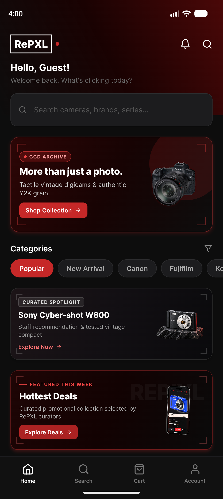

*Figure 4. Existing standalone native Home capture from the October 21, 2026 Pixel 10 Pro installation. Copied unchanged from <code>react-native/.expo/apk-rebuild-2026-10-21/launch.png</code>. It shows guest search/navigation and promotional content; it does not prove login, checkout, orders, or physical-device behavior.*

Logo/catalog pictures are assets, not runtime module screenshots. New browser capture was blocked by execution policy. No authenticated module was signed into for this task.

| Required capture | Description | Status |
|---|---|---|
| Homepage | Branding, navigation, hero/discovery at <code>/</code>. | Pending. |
| Registration/login/recovery/MFA | Actual forms/challenge with credentials hidden. | Pending. |
| Catalog/search | Real products, filters, count, pagination. | API evidence available; screen pending. |
| Product/reviews | Price, stock, grade, specifications, feedback. | Pending. |
| Compare/wishlist | Selected/saved cameras. | Pending. |
| Cart | Selected items/quantities/summary. | Pending. |
| Checkout | All four steps and totals, no real card data. | Pending. |
| Confirmation/orders/tracking | Same transaction across customer/admin. | Pending; redact personal data. |
| Account/security/notifications | Profile, address, preferences, safe security views. | Pending; no OTP/recovery secrets. |
| Returns | Customer request/progress and matching admin case. | Pending; check migration/prerequisites. |
| Admin login/dashboard | Role entry and real summaries. | Pending. |
| Camera/inventory/archive | Create/read/update/archive accurately. | Pending. |
| Orders/customers/vouchers | Permitted management operations. | Pending. |
| CMS CRUD | Same disposable draft created/read/updated/deleted. | Pending. |
| Admin notifications/logs/settings/accounts | Templates, audit, configuration, authorized accounts. | Pending. |
| Native Home | Standalone emulator launch. | **Included: Figure 4**, existing dated evidence. |
| Native transaction screens | Product/compare/cart/address/checkout/payment return/orders/reviews/returns. | Pending on installed build. |

Use the [demo recording script](./demo-recording-script.md) to collect customer, login, admin/database, and mobile evidence. Actual recordings and submission links are separate deliverables.

---

## VII. Members' Contribution

Names, leader designation, portraits, and contributions come from Phase 1/2. They establish documented work, not inferred coding authorship. Additional implementation claims require member confirmation. Portraits were extracted unchanged from Phase 1; confirm their currentness and the template's 1×1-inch print sizing during final formatting.

| Name/role | Supplied photo | Documented contribution | Reflection status |
|---|---|---|---|
| **Tupaen, Arianne Kaye E. — Leader** |  | Phase 1: executive summary, project overview, integration/architecture discussion. Phase 2: high-level diagram covering frontend, backend, database, external services, deployment. | Personal reflection pending. Suggested focus: connecting the concept to architecture and coordinating the group. |
| **Romualdo, Jervin Paul C. — Member 1** |  | Phase 1: functional requirements and three-to-five-year features. Phase 2: module/function breakdown, purposes, dependencies. | Personal reflection pending. Suggested focus: translating requirements to modules and identifying gaps. |
| **Rosario, Ariane Joy P. — Member 2** |  | Phase 1: nonfunctional/background-related content, products/images. Phase 2: diagram assistance identifying APIs/backend integration. | Personal reflection pending. Suggested focus: media/data quality and integration requirements. |
| **Sevilla, Ma. Rosa Camilla S. — Member 3** |  | Phase 1: mission, strategic goals, nonfunctional requirements, future features. Phase 2: diagram identification of payment and proposed courier/logistics APIs. | Personal reflection pending. Suggested focus: proposed versus implemented external services. |
| **Sostea, Joana Marie A. — Member 4** |  | Phase 1: company background/mission. Phase 2: core application description covering customer/admin functions. | Personal reflection pending. Suggested focus: aligning the business description with final user journeys. |

Each member should describe actual work, a concrete difficulty, learning, and the group's resolution or remaining limit. These prompts are not first-person testimony submitted on anyone's behalf.

---

## VIII. Appendices

### Appendix A. Product catalog and media

Phase 1 proposed early/mid/late-2000s cameras, bags, memory cards, batteries, tripods, lenses, and cleaning accessories. That proposal remains in the original document; it is not treated as current inventory.

The table records **all 29 active products returned by the published API on October 21, 2026**. Prices are the returned PHP amounts, not seed prices or market valuations. Descriptions summarize listing text, whose manufacturer specifications were not independently certified. Photos were extracted unchanged from those same public records. Names link to deployed detail pages.

**The requirement for at least 30 products with descriptions, prices, and media remains open.** No thirtieth item has been fabricated. The committed seed and local product fixture contain 12 initial examples and do not reproduce the live catalog.

| No. | Camera | Listing description summary | Price (PHP) | Grade | Existing listing image |
|---|---|---|---|---|---|
| 1 | [Panasonic Lumix DMC‑LZ2](https://repxlph.vercel.app/products/panasonic-lumix-dmc-lz2) | The Panasonic Lumix DMC‑LZ2, launched in 2005, is a compact digital camera designed for users who want more zoom power in a simple package. | ₱4,499.00 | Mint | 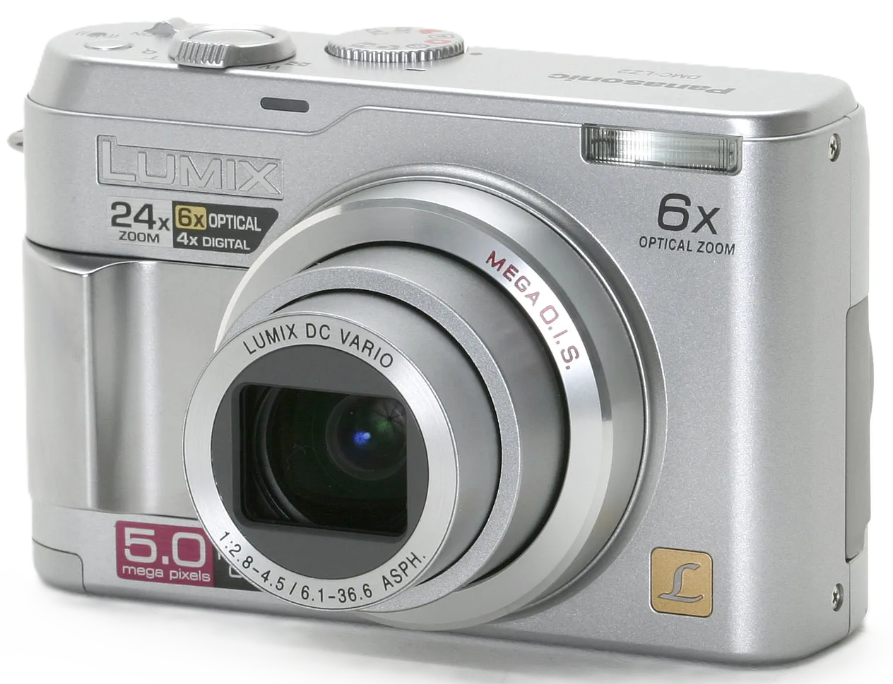 |
| 2 | [Kodak EasyShare DX4900](https://repxlph.vercel.app/products/kodak-easyshare-dx4900) | The Kodak EasyShare DX4900, released in 2002, is a compact digital camera designed to deliver high‑quality images for everyday users. | ₱3,499.00 | Excellent |  |
| 3 | [Kodak EasyShare V570](https://repxlph.vercel.app/products/kodak-easyshare-v570) | The Kodak EasyShare V570, launched in 2006, is a stylish ultracompact camera notable for its innovative dual-lens system. | ₱6,499.00 | Mint |  |
| 4 | [Kodak EasyShare CX6330](https://repxlph.vercel.app/products/kodak-easyshare-cx6330) | The Kodak EasyShare CX6330, released in 2003, is a compact point‑and‑shoot camera designed for everyday use. | ₱2,999.00 | Good | 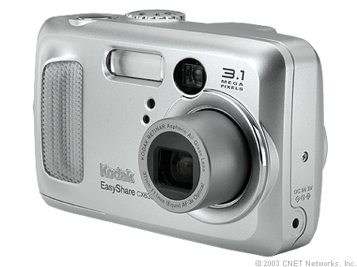 |
| 5 | [Fujifilm FinePix Z2](https://repxlph.vercel.app/products/fujifilm-finepix-z2) | The Fujifilm FinePix Z2, launched in 2005, is a stylish ultracompact camera designed for portability and ease of use. | ₱3,999.00 | Excellent | 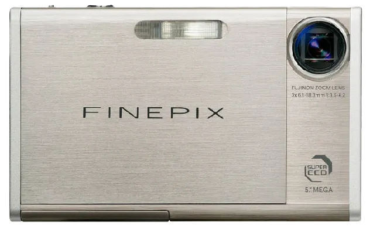 |
| 6 | [Fujifilm FinePix F31fd](https://repxlph.vercel.app/products/fujifilm-finepix-f31fd) | The Fujifilm FinePix F31fd, released in 2006, is a compact digital camera renowned for its excellent low-light performance. | ₱2,499.00 | Fair |  |
| 7 | [Fujifilm FinePix 2600 Zoom](https://repxlph.vercel.app/products/fujifilm-finepix-2600-zoom) | The Fujifilm FinePix 2600 Zoom, released in 2001, is a compact digital camera designed for everyday photography. | ₱3,499.00 | Good | 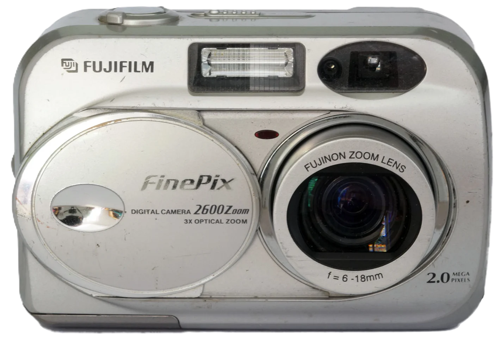 |
| 8 | [Canon IXUS 980 IS (SD990 IS)](https://repxlph.vercel.app/products/canon-ixus-980-is-sd990-is) | The Canon IXUS 980 IS (PowerShot SD990 IS Digital Elph) is a premium compact camera released in 2008, offering one of the highest resolutions of its time with a 14.7 megapixel CCD sensor. | ₱7,999.00 | Mint | 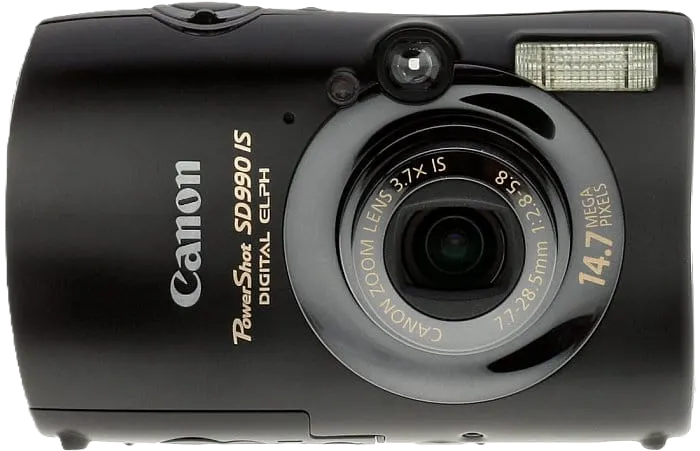 |
| 9 | [Canon Digital IXUS V](https://repxlph.vercel.app/products/canon-digital-ixus-v) | The Canon Digital IXUS V, released in 2001, is a stylish stainless-steel compact camera that helped define Canon’s iconic IXUS line. | ₱3,999.00 | Excellent | 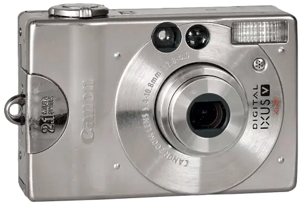 |
| 10 | [Canon Digital IXUS 65](https://repxlph.vercel.app/products/canon-digital-ixus-65) | The Canon Digital IXUS 65 is a stylish ultracompact camera released in 2006, designed to combine elegance with performance. | ₱1,999.00 | Good | 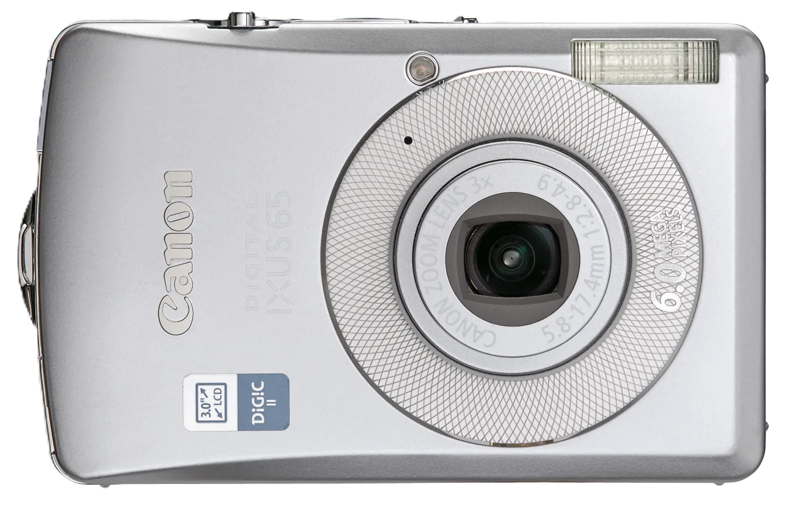 |
| 11 | [Panasonic Lumix DMC‑LC20](https://repxlph.vercel.app/products/panasonic-lumix-dmc-lc20) | Entry‑level compact digicam released in 2002. | ₱2,199.00 | Excellent | 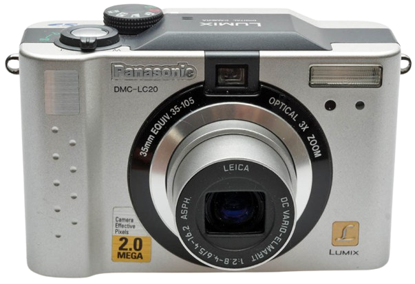 |
| 12 | [Sony Cyber‑shot DSC‑P3](https://repxlph.vercel.app/products/sony-cyber-shot-dsc-p3) | Compact digicam released in 2001. | ₱2,799.00 | Excellent | 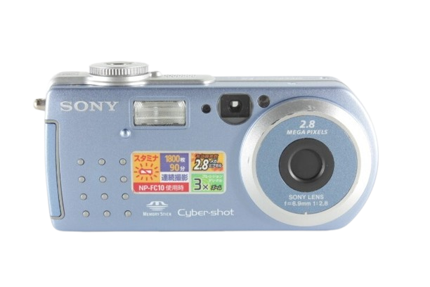 |
| 13 | [Sony Cyber‑shot DSC‑S70](https://repxlph.vercel.app/products/sony-cyber-shot-dsc-s70) | Premium compact digicam released in 2000. | ₱3,499.00 | Good | 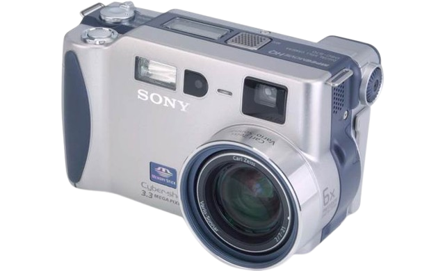 |
| 14 | [Sony Cyber-shot DSC-W30](https://repxlph.vercel.app/products/sony-cyber-shot-dsc-w30) | Compact digicam released in 2006. | ₱3,199.00 | Excellent |  |
| 15 | [Nikon Coolpix S6](https://repxlph.vercel.app/products/nikon-coolpix-s6) | Slim Wi‑Fi‑enabled compact digicam released in 2005. | ₱2,499.00 | Good | 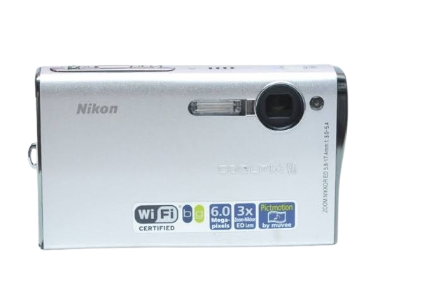 |
| 16 | [Nikon Coolpix S710](https://repxlph.vercel.app/products/nikon-coolpix-s710) | Stylish compact digicam released in 2008. | ₱3,499.00 | Excellent | 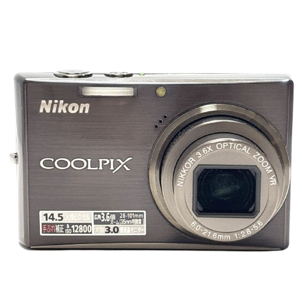 |
| 17 | [Nikon Coolpix 2500](https://repxlph.vercel.app/products/nikon-coolpix-2500) | Compact swivel‑lens digicam released in 2002. | ₱3,199.00 | Good |  |
| 18 | [Panasonic Lumix DMC-TZ3](https://repxlph.vercel.app/products/panasonic-lumix-dmc-tz3) | The TZ3 was Panasonic's travel zoom revelation — a 10x Leica lens in a body barely larger than a deck of cards. | ₱6,100.00 | Excellent | 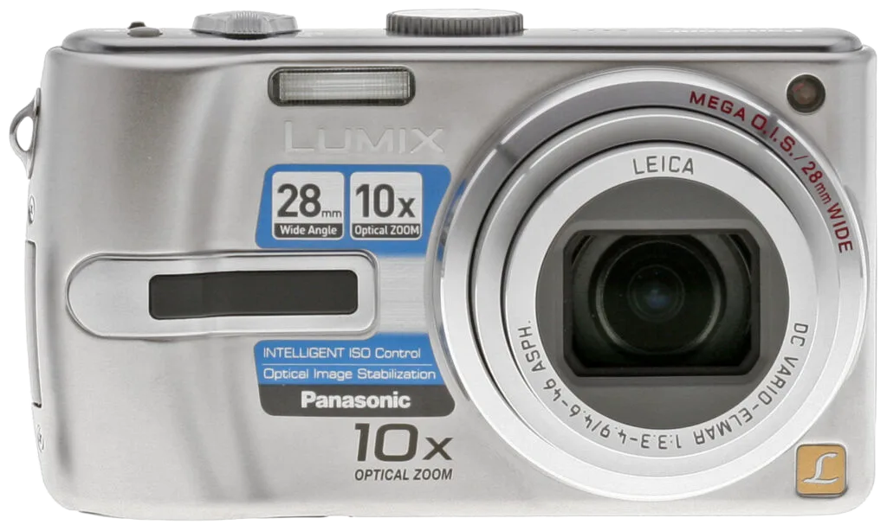 |
| 19 | [Fujifilm FinePix A500](https://repxlph.vercel.app/products/fujifilm-finepix-a500) | The A500 was Fuji's entry point in 2007 — 5.1 megapixels, basic controls, and a plastic body that doesn't pretend to be more than it is. | ₱1,499.00 | Fair | 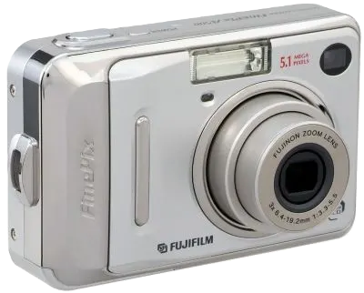 |
| 20 | [Kodak PixPro FZ53](https://repxlph.vercel.app/products/kodak-pixpro-fz53) | A modern camera wearing vintage colors. | ₱3,799.00 | Good |  |
| 21 | [Sony CyberShot DSC-P200](https://repxlph.vercel.app/products/sony-cybershot-dsc-p200) | Sony's 2005 flagship compact — the P200 married a Carl Zeiss Vario-Tessar lens to a 7.2MP sensor in a flat, all-metal body that still looks futuristic. | ₱4,500.00 | Mint | 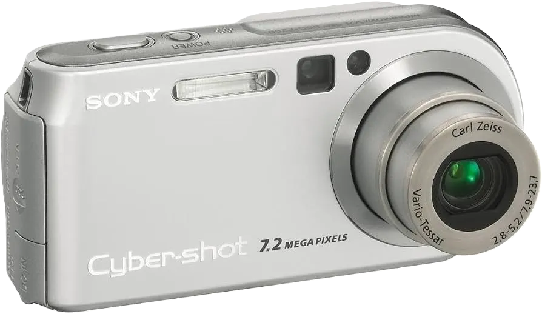 |
| 22 | [Nikon Coolpix 5600](https://repxlph.vercel.app/products/nikon-coolpix-5600) | Nikon's 2005 refresh of the Coolpix line brought 5 megapixels and a more refined JPEG engine to the pocketable format. | ₱3,800.00 | Excellent | 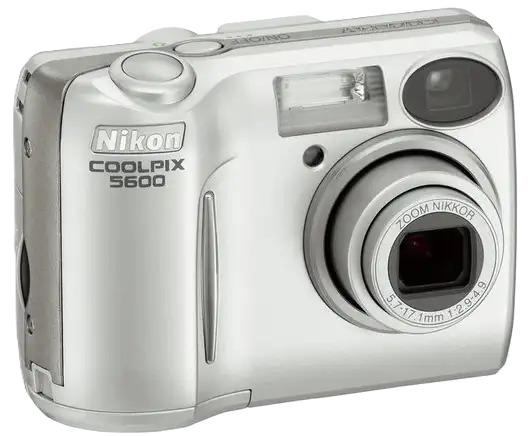 |
| 23 | [Canon IXUS 400](https://repxlph.vercel.app/products/canon-ixus-400) | The IXUS 400 was Canon's premium compact in 2003 — a stainless steel body that felt like jewelry, paired with a fast f/2.8 lens. | ₱3,499.00 | Good |  |
| 24 | [Panasonic Lumix DMC-FZ7](https://repxlph.vercel.app/products/panasonic-lumix-dmc-fz7) | The FZ7 punched well above its weight class in 2006: a Leica-branded 12x optical zoom in a body small enough for a jacket pocket, paired with Panasonic's MEGA O.I.S. | ₱4,500.00 | Mint |  |
| 25 | [Kodak EasyShare C300](https://repxlph.vercel.app/products/kodak-easyshare-c300) | The camera that lived in everyone's junk drawer — and that's exactly why people love it now. | ₱1,499.00 | Fair |  |
| 26 | [Fujifilm FinePix F30](https://repxlph.vercel.app/products/fujifilm-finepix-f30) | Widely considered the best high-ISO compact of its generation. | ₱4,999.00 | Excellent | 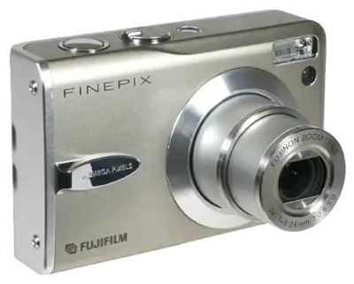 |
| 27 | [Sony CyberShot W800](https://repxlph.vercel.app/products/sony-cybershot-w800) | The W800 bridges the gap between vintage charm and modern resolution — 20.1MP in a body that still looks and feels like a classic CyberShot. | ₱2,600.00 | Good |  |
| 28 | [Nikon Coolpix 3200](https://repxlph.vercel.app/products/nikon-coolpix-3200) | A true time capsule. | ₱2,500.00 | Mint |  |
| 29 | [Canon PowerShot A520](https://repxlph.vercel.app/products/canon-powershot-a520) | The A520 was Canon's entry-level workhorse in 2005 — 4 megapixels, a surprisingly sharp 4x zoom lens, and that signature Canon CCD warmth that flatters skin tones without trying. | ₱4,299.00 | Good |  |

The phases also link to the [Group 2 product-image folder](https://drive.google.com/drive/folders/1E0M7zjDoglmWziZiYSFkD8knRVgoMtfC?usp=sharing). Its access, completeness, licensing, and source attribution were not audited. Check image ownership and manufacturer details before final publication/submission.

### Appendix B. Source, setup, and deployment

| Material | Location/purpose |
|---|---|
| Full source | [GitHub](https://github.com/yashiro-nyx/RePXL-Website); identify the reviewed revision in final submission. |
| Website scripts | [package.json](../package.json). Build generates Prisma Client/compiles Next.js; vercel-build also deploys migrations. |
| Database | [Schema](../prisma/schema.prisma), <code>prisma/migrations/</code>. Migration presence is not proof of deployment. |
| Architecture | [Guide](./system-architecture.md) and Figures 2–3; shared modules, not independent internal services. |
| Setup/hosting | [Setup](./SETUP.md), [Deployment](./deployment.md); do not include secret values. |
| Workflows | [Checkout](./checkout.md), [Returns](./returns.md), [Communications](./communications.md), [Customer experience](./customer-experience.md). |
| Security | [Step-up/MFA](./security-step-up.md), [Error handling](./error-handling.md). |
| Native | [Development plan](./mobile-app-development-plan.md), [Native README](../react-native/README.md). |
| Tests | Root suites, Vitest config, stress harness; fresh checks in Chapter III, runtime limits in Chapter IX. |

### Appendix C. Presentation and group activity evidence

| Material | Status |
|---|---|
| PowerPoint/slides | Final artifact not identified in supplied documents; attach the group's actual presentation. |
| Project creation photos | Authentic dated activity photos not supplied; portraits are not substitutes. |
| Meeting photos/minutes | Not supplied; attach authentic captioned records. |
| Oral presentation photos | Not supplied; attach after presentation. |
| Demonstration videos | Script exists; final uploaded links/completion require confirmation. |
| Module screenshots | Chapter VI lists outstanding captures. |
| Library evidence | Confirm campus holdings/call numbers and actual consultation. |
| Product minimum | One additional fully evidenced active product is needed to reach 30 in this snapshot. |
| Runtime stress results | Request tree, table, measured summary pending. |

### Appendix D. Honor pledge and signatures

The supplied template requests:

> “We affirm that we have not given or received any unauthorized help on this assignment and that this work is our own.”

This is reproduced for member review, not signed or attested on their behalf. Members must check their submission and assistance disclosures against instructor requirements before signing.

| Full name | E-signature/date |
|---|---|
| Tupaen, Arianne Kaye E. | Pending member signature/date. |
| Romualdo, Jervin Paul C. | Pending member signature/date. |
| Rosario, Ariane Joy P. | Pending member signature/date. |
| Sevilla, Ma. Rosa Camilla S. | Pending member signature/date. |
| Sostea, Joana Marie A. | Pending member signature/date. |

---

## IX. Stress Testing Analysis and Data Results

### 1. Available tools and evidence

The repository has <code>scripts/stress-test.mjs</code>, exposed through <code>npm run test:stress</code>. It measures health, catalog, and search/filter request groups using a worker pool. Defaults are 20 concurrent workers and 100 requests per scenario, with target/scenario options. It supports the search scenario even though the short header omits it.

The root suite includes <code>src/app/api/stress/stress-concurrency.test.ts</code>. It mocks database/authentication behavior and tests health/conflict handling. These regressions are **not runtime load measurements**. The full root run passed 1,415 tests with 47 skipped; that count does not imply stress-test completion.

No runtime stress run, JMeter report, request CSV, result-tree capture, or measured latency/throughput artifact was produced here. The sections below document the available method and missing results.

### 2. View Results Tree

The Node harness prints summaries; it does **not** create a JMeter “View Results Tree.” If that exact output is required, run an approved plan in JMeter against a prepared test environment and attach the authentic tree. Record endpoint, timestamp, expected/actual status, duration, and response assertions; remove credentials, tokens, cookies, and personal data.

| Sampler | Routes | Interpretation |
|---|---|---|
| Health | <code>/api/health</code> | Healthy success requires DB connectivity; record degraded failures honestly. |
| Catalog/content | <code>/api/products?limit=12</code>, <code>/api/banners</code>, <code>/api/cms/homepage</code>, brand query | Assert status and expected data shape/content. |
| Search/filter | Camera name, brand/condition, price range, sorting | Confirm results satisfy the query, beyond absence of server errors. |

**Result-tree status:** unavailable; no performance pass/fail conclusion.

### 3. View Results in Table

After preparing the app, migrations, and controlled test data, the existing harness can be reproduced as follows:

~~~powershell
npm run build
npm run start -- --hostname 127.0.0.1 --port 3017
# In another terminal, once the server is ready:
npm run test:stress -- --target http://127.0.0.1:3017 --concurrency 20 --requests 100 --scenario all
~~~

These are instructions, not executed load-test results. Use a dedicated test backend/database: a local server can still target a shared remote DB. Production stress load requires an agreed test window. The harness lacks durable per-request CSV/table export, so detailed evidence needs a separate capture workflow.

| Scenario | Requests | Concurrency | Status distribution | Mean/P95 | Throughput | Result |
|---|---|---|---|---|---|---|
| Health | Not measured | Not measured | Not measured | Not measured | Not measured | Not evaluated. |
| Catalog/content | Not measured | Not measured | Not measured | Not measured | Not measured | Not evaluated. |
| Search/filter | Not measured | Not measured | Not measured | Not measured | Not measured | Not evaluated. |

### 4. Summary result and analysis

| Metric | Harness behavior | Limit/required evidence |
|---|---|---|
| Status/error rate | Counts status 0 and 5xx as errors. | 4xx can count toward printed “success”; separately assert expected outcomes. |
| Latency | Minimum/average/P50/P90/P95/P99/maximum of positive durations. | Report failure treatment; summary alone does not establish target compliance. |
| Throughput | Completed requests divided by scenario time. | Record hardware/process, data, DB location, warmup, workload with measurements. |
| Timeouts | Fetch has no explicit request timeout. | Hung requests may delay completion. |
| Queries | Sends configured search/filter URLs. | Does not validate payloads or prove filters took effect. |
| Phase 1 targets | Pages ≤3 seconds; search/key interactions ≤2 seconds; 99.5% availability. | Browser timings, interaction tests, and sustained monitoring are still needed. |
| Transaction concurrency | Mocked regressions plus guarded stock/finalizer logic. | Real competing checkout tests need controlled database evidence. |

**Analysis:** The code provides a basis for health/read-load evaluation and current regressions pass. It does not establish maximum supported users, measured latency, sustained throughput, or uptime. The final stress deliverable remains incomplete until authentic request records, required views, summary metrics, and environment-specific interpretation are attached.
